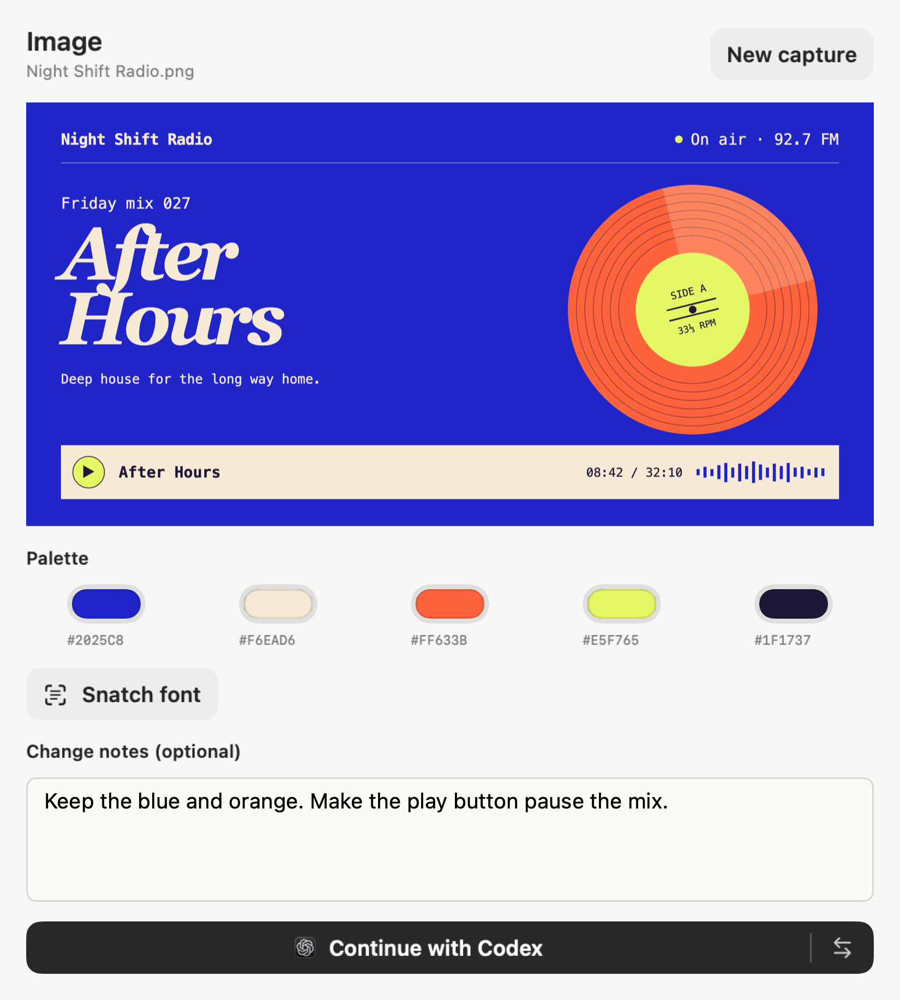

<h1 align="center">Poach</h1>

A lightweight Mac app for the UI you wish you’d made.

<strong><a href="https://github.com/guilopeszw/poach/releases/download/v0.1.0-beta.2/Poach-arm64.zip">Download for Apple silicon</a></strong> · <a href="docs/media/poach-demo.mp4">Watch the demo</a>

## Get started

1. **Install Poach.** Unzip the download and move **Poach.app** to Applications. Recording requires macOS 15 or later. On macOS 14, you can import images and videos.
2. **Connect your assistant.** Install its MCP connector below, then open a new chat.

   | Assistant | Setup |
   | --- | --- |
   | [Codex installer](https://github.com/guilopeszw/poach/releases/download/v0.1.0-beta.2/Poach-Codex-upgrade.zip) | Unzip and double-click **Install Codex.command**. |
   | [Claude Desktop extension](https://github.com/guilopeszw/poach/releases/download/v0.1.0-beta.2/Poach.mcpb) | Open **Settings → Extensions → Advanced settings → Install Extension**. Select the downloaded file and enable Poach. |

3. **Share a moment.** Record up to 30 seconds or drop a file into Poach. Pause the clip, add a timestamped comment, then choose **Copy handoff for chat** and paste it into your conversation. Try *“Recreate the hover effect I marked at two seconds.”*

Download and first-launch help

Sign in to a GitHub account with access to the private beta. The app includes its runtime and video tools.

This beta is locally signed. If macOS blocks it, review **System Settings → Privacy & Security → Open Anyway**. To record, grant Poach access under **Screen & System Audio Recording** and reopen it if prompted.

Keep Poach in Applications so the connector can find it. If the handoff button is disabled, open a new chat with the connector enabled. Manual connector settings are available in Poach’s **Settings** tab.

What does my assistant receive?

Poach processes media on your Mac. When the assistant reads a handoff, it receives the requested frames and notes. A new handoff replaces the previous one. Each expires after 24 hours.

[Contributing and local development](CONTRIBUTING.md) · [License](LICENSE)
