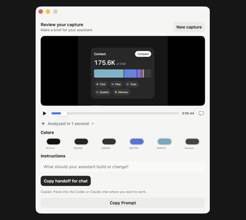

# Poach

Record an interface interaction, leave a note at the moment that matters, and ask Codex or Claude to build what you saw. Your assistant can inspect individual video frames through Poach’s MCP connector.

[Watch the demo video](docs/media/poach-demo.mp4) · [Download Poach Beta 2](https://github.com/guilopeszw/poach/releases/download/v0.1.0-beta.2/Poach-arm64.zip)

## Install on your Mac

Use an Apple silicon Mac with macOS 15 or later for screen recording. On macOS 14, you can import videos and images. The beta includes Node.js and FFmpeg. Sign in to GitHub with an account that has access to the private release.

Unzip **Poach-arm64.zip**, move **Poach.app** to Applications, and open it. This beta uses a local signing certificate. If macOS blocks the first launch, review it under **System Settings → Privacy & Security → Open Anyway**. When you first record, allow Poach in **Screen & System Audio Recording** and reopen it if prompted.

## Connect your assistant

| Assistant | Install the MCP connector |
| --- | --- |
| Codex | Download the [Codex installer](https://github.com/guilopeszw/poach/releases/download/v0.1.0-beta.2/Poach-Codex-upgrade.zip), unzip it, and double-click **Install Codex.command**. It also updates an older local Poach installation. Open a new Codex chat. |
| Claude Desktop | Download the [Claude extension](https://github.com/guilopeszw/poach/releases/download/v0.1.0-beta.2/Poach.mcpb). In **Settings → Extensions → Advanced settings → Install Extension**, select the file and enable Poach. Open a new Claude chat. |

Keep Poach in Applications so both connectors can find it. Poach’s **Settings** tab also offers a configuration you can copy for manual setup.

## Try your first handoff

1. In Poach, select a screen area, full screen, or window and record up to 30 seconds. You can also drop an image or a video onto the Capture tab.
2. In the editor, pause on an interaction and click the comment icon. Add a timestamped note, adjust the colors, or describe what you want your assistant to build.
3. Choose **Copy handoff for chat** and paste it into your connected conversation. Try asking, “What changes when the pointer hovers over Files at two seconds?” If the button is disabled, open a chat with the connector enabled.

Poach processes media on your Mac. When your assistant reads a handoff, it receives the requested frames and notes. Sharing again replaces the previous brief. Each brief expires after 24 hours.

[Contributing and local development](CONTRIBUTING.md) · [License](LICENSE)
